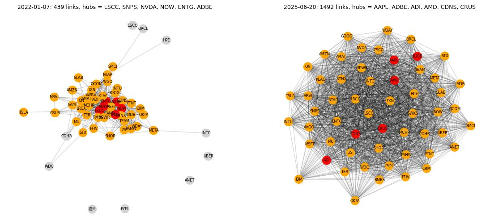
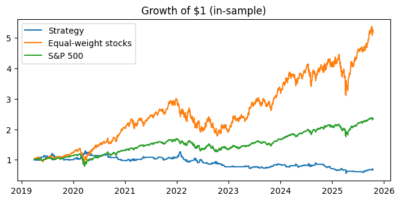
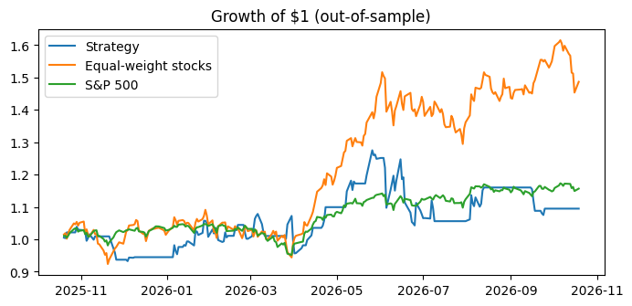
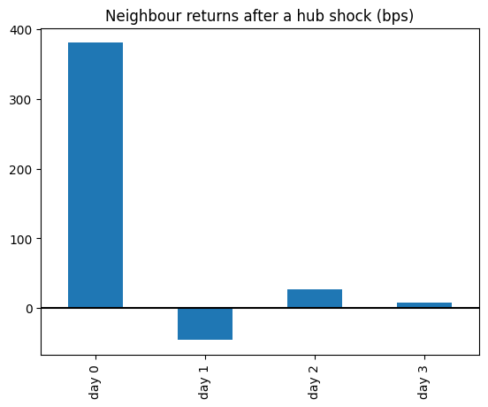
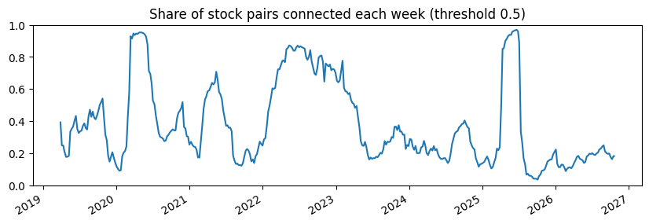

# Strategy 01: Lead-Lag Centrality

**Status:** Negative result (to revisit)  
**Asset class:** US tech and semiconductor equities  
**Code:** [lead-lag-centrality-strategy](https://github.com/NakulPillai2407/lead-lag-centrality-strategy)  
**Report:** [Full report (PDF, 20 pages)](../assets/lead-lag/lead-lag-centrality-report.pdf)  
**Playground:** not yet built

!!! warning "Headline result"
    Built exactly as specified and locked before the backtest ran, the strategy **does not beat simply holding the same stocks**, in sample or out of sample. The reason is informative: neighbouring stocks do move with a hub, but almost entirely **on the same day**, so there is no multi-day catch-up to trade.

## 1. Hypothesis

Some stocks are watched much more closely than others. When one of these highly connected "hub" stocks makes a sharp move, economically linked but less-watched peers should not react straight away. They should catch up over the following days. The strategy is to watch hubs for a sharp move, then trade their connected peers in the same direction.

**Why it might work.** Analysts, passive index flows and algorithmic traders concentrate on the most liquid, most-covered names, so new information is priced into them almost immediately. Linked peers share real exposure through overlapping end demand, shared input costs or a common sector narrative, but get less continuous attention, so their prices should adjust more slowly. This is an instance of the gradual information diffusion and limited-attention literature (Hou and Moskowitz, 2005; Cohen and Frazzini, 2008), not a generic trend-following story.

**Why this sector.** US tech and semiconductors combine a few extremely heavily covered mega-caps with a long tail of smaller, less-watched but economically linked peers (equipment makers, smaller analog and EDA firms).

**What would prove it wrong** (stated in advance):

- Connected peers move on the same day as the hub, with no measurable lag.
- A real lag exists but does not produce a positive risk-adjusted return after realistic costs (5 to 10 bps round trip), especially out of sample.
- The apparent "lag" is fully explained by ordinary same-day correlation.

## 2. Data and universe

- **Universe:** 65 US tech and semiconductor tickers (mega-cap tech, semiconductor makers and equipment, smaller cloud and software names), plus the S&P 500 as a market benchmark.
- **Data:** daily adjusted close prices from Yahoo Finance, from January 2019. Adjusted prices are used so splits and dividends do not appear as artificial jumps. The download is cached so every run uses an identical dataset.
- **Cleaning:** JNPR returned no data and was dropped. Any stock missing more than 5% of its trading days was removed rather than patched. That removed 8 tickers: ABNB, ALGM, PLTR, SNOW, DDOG, NET and CRWD (listed after 2019), and QRVO (almost no usable data on Yahoo). The final universe is **56 stocks**.
- **Gap filling:** small gaps are filled only inside a stock's existing history and only up to 5 days. Nothing is extended before a first trading day or after a last one.
- **Known limitation:** the universe is today's list of surviving names, not a point-in-time reconstruction (see [Limitations](#6-what-went-wrong-and-limitations)).

## 3. Signal construction

All parameters were fixed before the backtest was run and never tuned afterwards.

1. **Weekly network.** Each week, link two stocks if the correlation of their daily returns over the trailing 60 trading days exceeds 0.5. The network is rebuilt every week, giving 396 weekly networks.
2. **Hubs.** Compute degree centrality (the share of the other stocks a stock is linked to). The six most connected stocks that week are the hubs.
3. **Shocks.** A hub shock is flagged when a hub's daily return is more than twice its own trailing volatility, measured only up to the previous day:

    \[
    |r_{h,t}| > 2\,\sigma_{h,t-1}
    \]

    This produced **736 shocks** (639 in sample, 97 out of sample).
4. **Trade.** At the next day's close, buy an equal-weighted basket of the hub's connected neighbours (short if the hub fell). Hold for 3 days.
5. **Costs and sizing.** 10 bps round-trip cost per trade. Capital is split equally across open trades, with no leverage. A position was open on about 48% of trading days.

| Parameter | Value |
|-----------|-------|
| Correlation window | 60 trading days |
| Correlation threshold | 0.5 |
| Hub measure | Degree centrality, top 6 each week |
| Shock trigger | Return above 2x trailing volatility |
| Holding period | 3 days |
| Transaction cost | 10 bps round trip |

*Left: a typical week (7 Jan 2022), 439 links, one dense cluster with the hubs in red. Right: the stress week of 20 Jun 2025, 1,492 links, where almost every stock is tied to every other.*

**Which stocks became hubs.** The most frequent hubs were MPWR, KLAC, ENTG, AMAT, LRCX, ADI, CDNS, MCHP, AVGO and SNPS: semiconductor equipment, analog and EDA names, not the mega-caps the hypothesis expected. Averaged over all weekly networks, AAPL ranks 29th of 56 on degree centrality, MSFT 18th, GOOGL 35th, AMZN 28th, META 45th, TSLA 53rd and NVDA 14th. Centrality here seems to reflect shared exposure to the semiconductor cycle rather than which stocks are most watched.

## 4. Backtest results

The final 12 months were held out from the whole design process and used once, at the end. The in-sample period is about 6.5 years. Benchmarks are an equal-weighted holding of all 56 stocks and the S&P 500.

### In sample

| Series | Cumulative return | Annualised return | Sharpe | Max drawdown | Sortino | Win rate |
|--------|------------------:|------------------:|-------:|-------------:|--------:|---------:|
| **Strategy (with costs)** | -32.8% | -5.9% | -0.163 | -57.1% | -0.148 | 49.8% |
| Strategy (no costs) | -12.7% | -2.1% | 0.018 | -49.9% | 0.017 | 51.9% |
| Equal-weight stocks | 424.3% | 28.8% | 0.969 | -40.8% | 1.327 | 55.0% |
| S&P 500 | 135.1% | 14.0% | 0.745 | -33.9% | 0.908 | 54.8% |

### Out of sample (final 12 months)

| Series | Cumulative return | Annualised return | Sharpe | Max drawdown | Sortino | Win rate |
|--------|------------------:|------------------:|-------:|-------------:|--------:|---------:|
| **Strategy (with costs)** | 9.5% | 9.5% | 0.453 | -18.2% | 0.458 | 50.0% |
| Strategy (no costs) | 14.1% | 14.1% | 0.590 | -17.7% | 0.595 | 50.4% |
| Equal-weight stocks | 48.7% | 48.9% | 1.582 | -14.6% | 2.480 | 57.0% |
| S&P 500 | 15.7% | 15.7% | 1.211 | -9.1% | 1.857 | 53.0% |

**Reading the results.**

- Both benchmarks beat the strategy on every metric in both periods: higher Sharpe and Sortino, smaller drawdowns.
- The win rate is about 50% in both periods, essentially a coin flip on the bets it makes.
- Removing costs lifts the in-sample Sharpe from -0.163 to about flat (0.018), so part of the in-sample loss comes from trading too often relative to the size of the edge, not only from a weak signal.
- The out-of-sample Sharpe (0.453) is better than the in-sample one, which is unusual and a reason for caution rather than celebration, given how sensitive it is to the threshold (below).
- Cumulative returns across the two periods are not directly comparable because of their different lengths. Annualised return, Sharpe and Sortino are the right comparison.

## 5. Robustness

### Does the mechanism exist? The lag test

The test that mattered most checks the mechanism directly: how do a hub's neighbours move on the shock day and the days after?

| Day after hub shock | Average neighbour move (bps, in the hub's direction) |
|---------------------|------------------------------------------------------:|
| Day 0 (shock day) | +380 |
| Day 1 | -46 |
| Day 2 | about +27 |
| Day 3 | about +8 |

Neighbours move strongly with the hub, but the move is absorbed almost entirely on the shock day. A real catch-up would show later days growing toward the day-0 size. Instead, day 1 is slightly negative. There is essentially no multi-day catch-up to trade, so the weak performance is a property of the hypothesis, not a bug in the pipeline.

### Correlation threshold sensitivity

Only the threshold was stress-tested. The 0.5 value was fixed in advance and kept.

| Threshold | Out-of-sample Sharpe |
|-----------|---------------------:|
| 0.4 | -0.318 |
| **0.5 (locked)** | **0.453** |
| 0.6 | 0.249 |

The result is not stable: it is negative at 0.4 and positive at 0.5 and 0.6. The single positive result at 0.5 should be treated with caution.

### Network behaviour in stress

The median network density at 0.5 is 28%. In market-wide stress it saturates: in the week of 20 June 2025 (whose window covers the April 2025 tariff sell-off), 97% of all pairs were linked. When almost everything is connected, degree centrality stops separating hubs from the rest, and the hub and neighbour distinction the strategy relies on effectively disappears.

### Pitfall checks

- **Look-ahead bias:** traced end to end on the first shock in the sample (network built on 29 Mar 2019, volatility measured to 2 Apr, shock on 3 Apr, trade entered on 4 Apr). Every step only uses information available before it, confirmed by an explicit check in the code.
- **Data snooping:** all parameters were committed to before the result was known.
- **Out-of-sample validation:** the last 12 months were used once, at the end.

## 6. What went wrong and limitations

- **The mechanism is not there at daily frequency.** Connected stocks move together on the same day, which the network captures, but there is no lagged catch-up.
- **Survivorship bias.** The universe is today's 56 surviving stocks (JNPR, for example, disappeared after HPE acquired it in 2025). This most likely inflates absolute returns for both the strategy and its equal-weight benchmark, so the underperformance finding holds up better than the raw returns do. A point-in-time constituents list would fix this.
- **Costs and slippage are simplified.** The 10 bps cost is applied once per trade and does not scale with position size or the liquidity of the neighbour stocks.
- **Concentration risk.** The hubs cluster in semiconductor equipment and analog names. A shock to that slice of the supply chain could trigger several trades at once that are really the same bet, so splitting capital equally would not diversify anything.
- **Capacity.** The number of shocks per year is fixed by the signal, so more capital would either concentrate in the same neighbour stocks or sit idle.
- **No risk reduction.** The strategy's drawdown was worse than both benchmarks in both periods.
- **Sensitivity.** Only the threshold was stress-tested, and it was not robust. The window length, hold period, shock size and number of hubs were never tested the same way.

## 7. Next steps

- **Test the lag first.** If repeated, check the mechanism directly before building a full backtest around it.
- **Intraday lag.** Any delayed reaction may exist within the day, at minute or hourly level, which daily data cannot see. This is an open question, not a ruled-out one.
- **Point-in-time universe** to remove survivorship bias.
- **Broader parameter sensitivity** across the window, hold period, shock size and number of hubs.
- **Realistic slippage model** that depends on position size and liquidity.
- **Alternative centrality measures** (eigenvector, betweenness) and non-semiconductor universes.

## 8. Links

- [Full report (PDF)](../assets/lead-lag/lead-lag-centrality-report.pdf)
- [Code and notebook](https://github.com/NakulPillai2407/lead-lag-centrality-strategy)

**References**

- Hou, K. and Moskowitz, T. (2005). Market frictions, price delay, and the cross-section of expected stock returns. *Review of Financial Studies*, 18(3).
- Cohen, L. and Frazzini, A. (2008). Economic links and predictable returns. *Journal of Finance*, 63(4).
