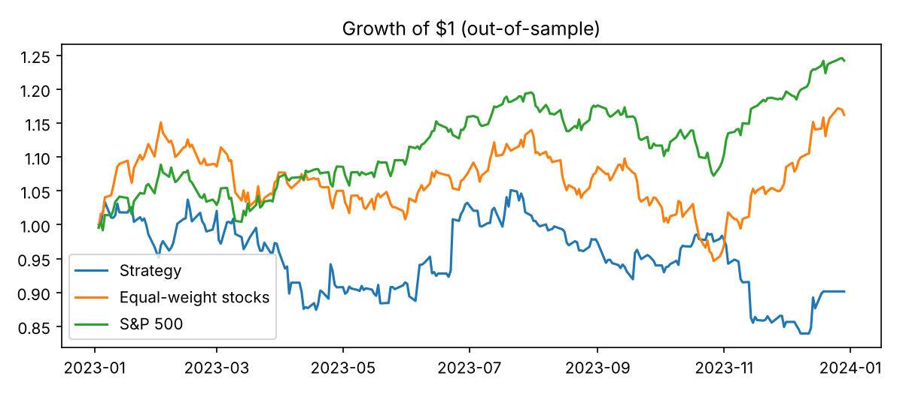
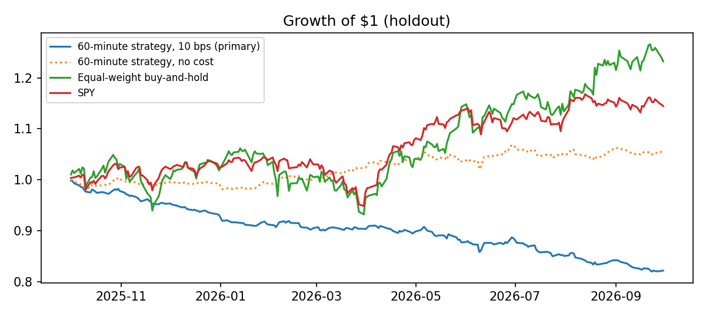
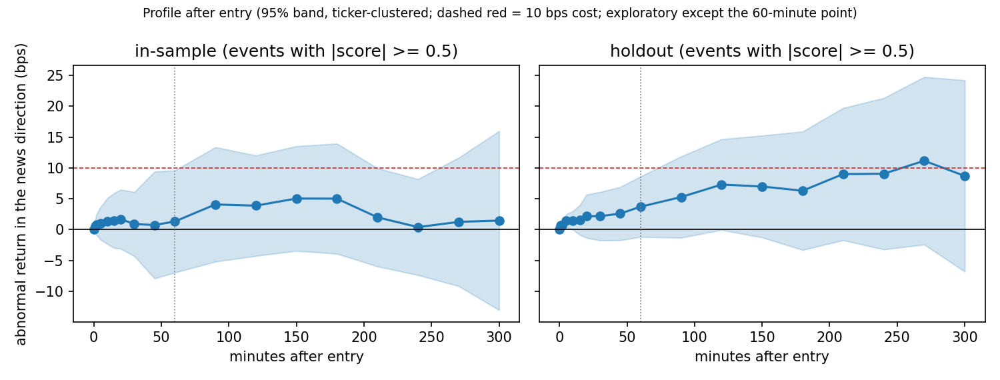

# HR-002: News Sentiment

**Status:** Negative result  
**Asset class:** US large-cap equities  
**Code:** [news-sentiment-research](https://github.com/NakulPillai2407/news-sentiment-research)  
**Reports:** [Daily test (PDF)](../assets/news-sentiment/news-sentiment-daily-report.pdf) and [intraday test (PDF)](../assets/news-sentiment/news-sentiment-intraday-report.pdf)  

!!! warning "Headline result"
    Tested twice, once with daily news and once with exact release times and 1-minute prices, trading on the sentiment of a headline **does not beat simply holding the same stocks**. Sentiment is strongly linked to returns on the day of the article, but by the time a trade can be placed, what is left is a few basis points, below the cost of trading it.

## 1. Hypothesis

When a company gets clearly good or bad news, the market does not finish pricing it in at once. A stock's abnormal return should keep moving in the direction of the news after the headline is out, by more than it costs to trade. The strategy is to score each headline with FinBERT, buy after clearly positive news and short after clearly negative news.

**Why it might work.** The tone of a story is soft, qualitative information that is harder to price than a number such as an earnings surprise. Prices have been found to under-react to negative words in firm news (Tetlock, Saar-Tsechansky and Macskassy, 2008) and to drift after bad headlines (Chan, 2003), and attention is limited and uneven (Barber and Odean, 2008). The evidence is not one-sided: media pessimism can also reverse rather than drift (Tetlock, 2007). In liquid US large caps, where algorithms read the same feeds within seconds, the reaction may well be over before a trade can be placed.

**What would prove it wrong** (stated in advance):

- The in-sample coefficient of the abnormal return on the sentiment score, at the trading horizon, is not positive and significant at 5%.
- The held-out net-of-cost Sharpe ratio does not beat the equal-weight benchmark.

Both had to hold. Neither did, in either test.

## 2. Data and universe

| | Test 1: daily | Test 2: intraday |
|---|---|---|
| News | FNSPID, dated to the day | Alpaca (Benzinga), exact release time |
| Prices | Daily adjusted closes | 1-minute bars (IEX feed) |
| Period | 2021 to 2023 | January 2024 to September 2026 |
| Held out | Last 12 months, used once | Last 12 months, used once |
| Universe | 50 US stocks drawn at random across industries | 50 US stocks drawn at random from the 84 most heavily covered |
| Time of day | Date only, no release time | Exact release time |
| Unit of observation | Stock-day: the mean score of that day's articles (15,592 stock-days from 28,078 articles) | One article-ticker pair (25,049, regular-hours releases only) |
| Text scored | Headline, plus the summary where the file has one | Headline only |

Multi-stock roundup articles are removed, because they say nothing about one stock, but the rule differs: the daily test drops a headline that appears on three or more of the universe's stocks on the same day, the intraday test drops articles tagged with more than two tickers. In the intraday test only articles released in regular hours are traded, since an after-hours article could only be traded at the next open. Both universes were drawn using article counts and a fixed seed, never prices.

## 3. Signal construction

All parameters were written down before the data was seen, and later changes are logged as dated deviations in each study's `PARAMETERS.md`.

1. **Score.** The headline's FinBERT score is the probability of positive minus the probability of negative, from -1 to +1. VADER is the comparison model.
2. **Signal.** Long at +0.5 or above, short at -0.5 or below.
3. **Abnormal return.** The stock's return minus its beta times the market's return, with beta estimated only from days before the event.
4. **Entry and exit.** Test 1 enters at the close of the article's date and holds one day. Test 2 enters at the open of the first minute bar starting at least 60 seconds after the release and holds 60 minutes, or to the close if that comes first.
5. **Costs and sizing.** 10 bps round trip (20 and 30 bps as checks), equal weight across the day's trades, no leverage, one open position per stock.

## 4. Backtest results

| Measure | Test 1 in sample | Test 1 held out | Test 2 in sample | Test 2 held out |
|---|---:|---:|---:|---:|
| Cumulative return, after costs | -42.0% | -9.8% | -39.8% | -17.8% |
| Cumulative return, before costs | -6.2% | +13.1% | -6.8% | +5.7% |
| Sharpe ratio, after costs | -0.81 | -0.34 | -5.04 | -3.74 |
| Sharpe ratio, before costs | 0.04 | 0.66 | -0.68 | 1.09 |
| Equal-weight stocks, Sharpe | 0.39 | 0.94 | 1.69 | 1.18 |
| Max drawdown, after costs | -48.1% | -20.1% | -39.7% | -17.8% |

Net returns in Test 2 look extreme because a 10 bps cost is charged on capital every day a trade is open, which compounds. The before-cost rows are the fairer read of whether there is a signal. Even before costs, neither test beat the equal-weight benchmark out of sample (0.66 against 0.94, and 1.09 against 1.18).

### Where the effect is

| Abnormal return per unit of sentiment | In sample | Held out |
|---|---:|---:|
| Test 1, article's own day | +110.2 bps (t = 4.65) | +78.1 bps (t = 4.40) |
| Test 1, next day (the trade) | +9.7 bps (p = 0.30) | +8.1 bps (p = 0.34) |
| Test 2, 60 minutes after entry (the trade) | +3.95 bps (p = 0.56) | +4.0 bps (p = 0.10) |

Sentiment is tightly tied to the move on the day of the article, which a trader cannot capture. What is left after the release is about the size of the cost or smaller.

## 5. Robustness

The checks below are for the intraday test unless a line says otherwise. The daily test also ran thresholds of 0.3 and 0.7, VADER in place of FinBERT and a no-cost version, all in its report; its net Sharpe at a 0.3 threshold is -0.95 in sample and -0.17 held out.

- **Horizons.** Test 2 also looked at 5, 15, 30, 120, 180, 240 and 300 minutes. All 16 estimates (8 horizons, 2 periods) are positive, from about 1 to 8 bps, and none beats the cost. Two have p below 0.05 (5 and 120 minutes, held out), which is about what chance gives across 16 tests.
- **Thresholds and model.** Net Sharpe is negative at every threshold (0.3, 0.5 and 0.7) and for both FinBERT and VADER, in both periods.
- **Costs.** At 20 and 30 bps the 60-minute held-out Sharpe falls from -3.74 to -8.57 and -13.40.
- **Standard errors.** Clustering by date instead of by stock gives the same answer.
- **Code checks.** Both notebooks were run on simulated data first: a planted effect was recovered, and a world with no effect gave nothing.

## 6. What went wrong and limitations

- **The reaction is over before a trade can act.** Daily data cannot show this, and minute data shows it directly.
- **The first design was replaced.** Test 1 began as a delayed three-day hold. That was swapped for an entry at the close of the article's date after the first results were seen, because the hypothesis was always to trade straight after the news. It is logged as a post-hoc deviation, so Test 1's held-out result is exploratory.
- **The daily test has a known bias in its favour.** Its news file has dates but no times, so some articles dated D were published after the close of D, and entering at that close is then slightly ahead of the information. This flatters the daily strategy, and it still lost.
- **Heavily covered stocks only.** The universes are today's well-known US stocks, where the market is fastest. Survivorship bias is likely.
- **Free price feed.** Test 2 uses the IEX feed, which carries part of market volume, so prices are approximate and some minutes have no bar. About 3.5% of signals were skipped for stale bars.
- **Costs are simplified.** A flat 10 bps ignores the wider spread just after a release and the cost of borrowing stock to short.
- **Exploratory leads are not results.** A 0.7 threshold had the best held-out Sharpe before costs (2.16), but in sample the same setting was negative (-0.83) and its held-out Sharpe after costs was still -2.09. Treat it as noise until it replicates on new data.

## 7. Next steps

- Tick-level data and faster execution, to test the first seconds after release.
- Measure the return in the minutes before each article, to see how much of the move had already happened.
- A spread and size cost model, with borrowing costs on shorts.
- Smaller and less covered stocks, where the market may be slower.
- A later period or new stocks to test the held-out leads.
- Scoring full article text and separating first reports from repeats.

## 8. Links

- [Daily test report (PDF)](../assets/news-sentiment/news-sentiment-daily-report.pdf)
- [Intraday test report (PDF)](../assets/news-sentiment/news-sentiment-intraday-report.pdf)
- [Code, notebooks and parameters](https://github.com/NakulPillai2407/news-sentiment-research)

**References**

- Barber, B. and Odean, T. (2008). All that glitters: the effect of attention and news on the buying behavior of individual and institutional investors. *Review of Financial Studies*, 21(2).
- Chan, W. (2003). Stock price reaction to news and no-news: drift and reversal after headlines. *Journal of Financial Economics*, 70(2).
- Tetlock, P. (2007). Giving content to investor sentiment: the role of media in the stock market. *Journal of Finance*, 62(3).
- Tetlock, P., Saar-Tsechansky, M. and Macskassy, S. (2008). More than words: quantifying language to measure firms' fundamentals. *Journal of Finance*, 63(3).
