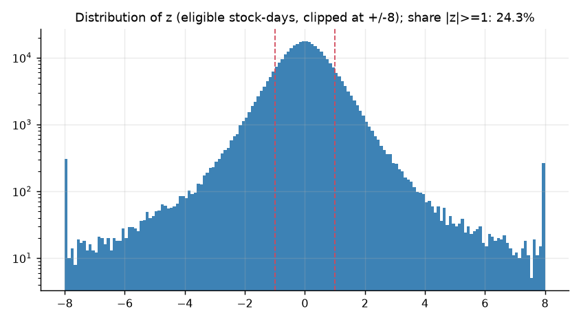
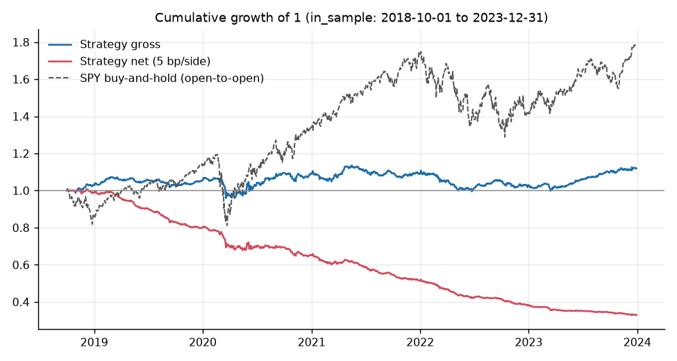
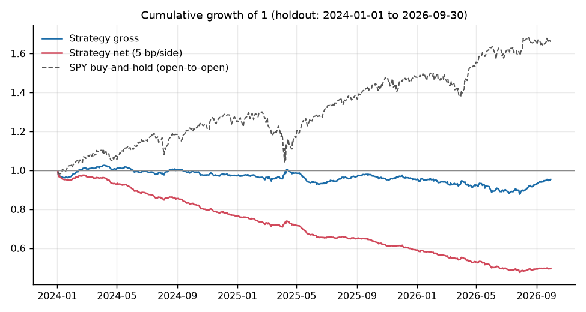
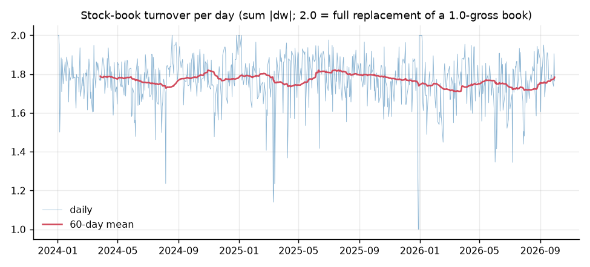

# HR-003: Sector Residual Reversion

**Status:** Negative result  
**Asset class:** US large-cap equities (S&P 500 members, point in time)  
**Code:** [sector-residual-reversion](https://github.com/NakulPillai2407/sector-residual-reversion)  
**Report:** [Full report (PDF, 20 pages)](../assets/sector-residual-reversion/sector-residual-reversion-report.pdf)  

!!! warning "Headline result"
    On a holdout that was run once, after every rule was frozen, the strategy **lost money before costs and far more after them**. The pre-registered rule returns **NOT SUPPORTED**: the reversal coefficient is -0.0040 (t = -0.66), the gross Sharpe ratio is -0.24 with an interval that includes zero, and the net Sharpe ratio at 5 bp per side is -4.02. The book trades about 1.77 times its size every day, so costs alone take roughly 22% a year.

## 1. Hypothesis

When a large US stock moves sharply for reasons specific to that company, rather than because its whole sector moved, part of that move should reverse the next day. The strategy removes the part of each stock's return that its sector ETF explains, scales what is left (the residual) by its recent volatility, buys the unusually negative ones and shorts the unusually positive ones. An ETF position cancels the leftover sector exposure, so the book is dollar-neutral and close to market-neutral.

**Why it might work.** A move that follows from sector news is more likely to be information and so should stick. The stock-specific leftover is more likely to come from one-sided trading that pushes the price away from fair value for a day, and that part should revert. Short-term reversal is an old, well-documented effect (Jegadeesh, 1990; Lehmann, 1990), residual and ETF-hedged versions are discussed by Avellaneda and Lee (2010), and a standing concern is that the gross profits have shrunk and that costs absorb what is left (Nagel, 2012). This study does not claim a new idea. It tests an old one properly.

**What would prove it wrong** (stated in advance):

- **H1a.** The holdout Fama-MacBeth coefficient of the next-day residual on today's residual is not negative with a Newey-West t-statistic below -2.
- **H1b.** The holdout net Sharpe ratio at 5 bp per side does not have a 95% bootstrap interval entirely above zero, or the alpha against SPY does not have t above 2.

SUPPORTED needs both. GROSS-ONLY means H1a holds, the gross Sharpe interval is above zero and H1b fails. Anything else is NOT SUPPORTED. My prior, written down before any data was downloaded, was GROSS-ONLY: a detectable effect before costs that does not survive costs.

## 2. Data and universe

- **Universe:** S&P 500 members at each date, across all 11 GICS sectors, each hedged against its SPDR sector ETF. A stock needs a prior close of at least $5. Benchmark: SPY.
- **Membership:** rebuilt from today's Wikipedia constituent list (503 tickers) by undoing the index additions and removals, working backwards. Five reconstruction issues are logged, not silently fixed.
- **Prices:** Yahoo Finance daily data. The download is cached and hashed. There are no delisting returns.
- **Windows:** in sample 2018-10-01 to 2023-12-31 (1,321 sessions); holdout 2024-01-01 to 2026-09-30 (689 sessions), used once. The raw prices were split into the two files at download.
- **Coverage:** the share of point-in-time members that could be traded rose from 86.0% in 2018 to 99.0% in 2026, because removed stocks often have no free prices.
- **Known limitation:** survivorship bias is reduced, not removed (see [Limitations](#6-what-went-wrong-and-limitations)).

## 3. Signal construction

All parameters were fixed before the build and never tuned.

1. **Residual.** For each stock and day, beta is a 60-day rolling OLS slope on its sector ETF using data through the previous day (at least 50 observations). The residual is

    \[
    e_{i,t} = r_{i,t} - \beta_{i,t-1}\, r_{\text{ETF},t}
    \]

2. **Signal.** \( z_{i,t} = e_{i,t} / \sigma_{i,t-1} \), where \( \sigma_{i,t-1} \) is the trailing 60-day standard deviation of residuals through the previous day.
3. **Trade.** Long stocks with z of -1 or lower, short stocks with z of +1 or higher. Each leg carries 0.5 gross. The ETF hedge cancels the net sector beta of the stock positions. The signal is read at the close of day t, entered at the open of t+1 and exited at the open of t+2.
4. **Costs.** 5 bp per side on stocks (2 and 10 bp as sensitivities), 1 bp per side on the ETF hedge and a flat 50 bp a year borrow on shorts.

| Parameter | Value |
|-----------|-------|
| Beta window | 60 trading days (minimum 50) |
| z-score window | 60 trading days (minimum 50) |
| Threshold | z of -1 or lower (long), +1 or higher (short) |
| Holding period | 1 day, rebuilt daily |
| Minimum price | $5 |
| Stock cost | 5 bp per side |
| Inference | Fama-MacBeth with Newey-West (5 lags); stationary bootstrap, 10,000 resamples |

*Holdout z over eligible stock-days, clipped at +/-8 (log scale). 24.3% of eligible stock-days have an absolute z of 1 or more.*

The code was tested before it saw any real return: it recovers a planted reversal (coefficient -0.0984 against a planted -0.10), finds nothing in a null world (3.0% of simulations with |t| above 2) and finds nothing when each stock is hedged against a deliberately wrong ETF. 13 unit tests, including look-ahead tests, pass.

## 4. Backtest results

The holdout was used once, after the freeze. Gross and net results are shown for the primary specification.

### In sample (2018-10-01 to 2023-12-31)

| Series | Annual return | Sharpe (95% CI) | Max drawdown |
|--------|--------------:|----------------:|-------------:|
| Gross | 2.4% | 0.35 (-0.48, 1.20) | -12.3% |
| Net, 2 bp per side | -7.9% | -1.15 (-2.00, -0.35) | -39.0% |
| **Net, 5 bp per side** | **-21.0%** | **-3.05 (-4.07, -2.15)** | **-67.4%** |
| Net, 10 bp per side | -42.8% | -6.20 (-7.70, -4.98) | -89.5% |

### Holdout (2024-01-01 to 2026-09-30)

| Series | Annual return | Sharpe (95% CI) | Max drawdown |
|--------|--------------:|----------------:|-------------:|
| Gross | -1.5% | -0.24 (-1.47, 0.96) | -14.4% |
| Net, 2 bp per side | -12.1% | -1.91 (-3.14, -0.69) | -32.8% |
| **Net, 5 bp per side** | **-25.5%** | **-4.02 (-5.39, -2.75)** | **-52.2%** |
| Net, 10 bp per side | -47.8% | -7.53 (-9.22, -6.10) | -73.0% |
| SPY buy-and-hold | n/a | 0.98 (0.00, 2.18) | n/a |
| Equal-weight 11 sector ETFs | n/a | 0.79 (-0.14, 1.99) | n/a |

**Reading the results.**

- The holdout coefficient is -0.0040 (Newey-West t = -0.66), about one twenty-fifth of the planted effect the code recovers in simulation. The sign is as hypothesised but it cannot be told from zero.
- Alpha against SPY is -26.0% a year (t = -6.50) with a beta of 0.029. It is negative because costs drag on a market-neutral book, not because of a bet against the market.
- The breakeven cost per side was 0.18 bp in sample and -0.71 bp in the holdout. A negative breakeven means the strategy lost money even with free trading.
- The holdout can only detect a Sharpe ratio of about 1.19 or more, so a modest real gross edge could have been missed. The honest reading is no detectable effect and a clear cost failure, not proof that no reversal exists.

| Decision rule (holdout) | Value | Met? |
|-------------------------|-------|------|
| H1a: coefficient negative, Newey-West t below -2 | -0.0040, t = -0.66 | No |
| H1b(i): net Sharpe at 5 bp, interval above 0 | -4.02, (-5.38, -2.75) | No |
| H1b(ii): alpha vs SPY with t above 2 | -26.0% a year, t = -6.50 | No |
| GROSS-ONLY: H1a plus gross Sharpe interval above 0 | H1a fails; (-1.46, 1.01) | No |

Note: the decision-rule intervals differ slightly from the results table above (for example -5.38 vs -5.39). The source report discloses the small difference; it was not investigated and does not change any conclusion.

Verdict: **NOT SUPPORTED**. This is weaker than my prior, because the gross effect was not detectable either.

## 5. Robustness

### Hedge choice and exclusions (pre-registered, holdout)

| Variant | Gross Sharpe | Net Sharpe at 5 bp |
|---------|-------------:|-------------------:|
| **Primary (sector-ETF hedge)** | **-0.24** | **-4.02** |
| SPY-only hedge | 0.04 | -2.77 |
| Excluding Visa, Mastercard, PayPal | -0.29 | -4.00 |
| Excluding the 10 largest names by dollar volume | -0.21 | -4.01 |
| Unhedged stock book | -0.22 | -3.53 |

### Threshold and holding period (exploratory, holdout, 5 bp)

These were never used to choose anything, and with this many comparisons a few will look better by chance.

| Variant | Gross Sharpe | Net Sharpe |
|---------|-------------:|-----------:|
| Threshold 0.5 | 0.13 | -4.07 |
| Threshold 1.5 | -0.16 | -3.26 |
| Threshold 2.0 | 0.26 | -2.04 |
| Hold 2 days | -0.22 | -2.91 |
| Hold 3 days | 0.10 | -2.05 |
| Hold 5 days | 0.14 | -1.49 |

Every gross interval includes zero. Longer holds and higher thresholds cut turnover and shrink the cost drag, but no variant makes a positive net Sharpe.

*Daily turnover of the stock book in the holdout. 2.0 is a full replacement of a 1.0-gross book.*

### Sectors

Only Utilities shows a holdout gross Sharpe interval entirely above zero (1.46, interval 0.12 to 2.77; net at 5 bp 0.11). With 11 sectors and several tests that is what chance alone produces. In sample, Materials and Industrials stood out and neither held up in the holdout. I draw no conclusion from any of these.

### Pitfall checks

- **Look-ahead bias:** beta and the z denominator at day t use data through day t-1, checked by unit tests. A further test confirms that profit and loss does not depend on future data.
- **Overfitting and snooping:** parameters, windows and the decision rule were fixed before any data was seen. The holdout was run once. Exploratory variants are labelled.
- **Holdout discipline:** the code refuses to load holdout prices unless a lock file exists and refuses to run the holdout twice.

## 6. What went wrong and limitations

- **Costs decide the result.** Turnover is about 1.77 times the book per day (about 446 a year). There is no gross edge to pay for it.
- **Survivorship bias.** Reduced, not removed. In sample, only 48% of the 157 removed members have usable data, against 100% of the survivors, and there are no delisting returns.
- **Current sector labels** are applied to the whole sample. Visa, Mastercard and PayPal were Information Technology until March 2023, which is why they are excluded in a robustness check.
- **Idealised execution.** Fills are assumed at the open, borrow is a flat 50 bp a year, and there is no market impact or capacity estimate.
- **Low power.** About 2.75 years of holdout can only detect a Sharpe of 1.19 or more.
- **Beta timing mismatch.** Betas are estimated on close-to-close returns but applied to open-to-open holds.
- **Free data.** Yahoo prices can contain errors. 11 in-sample and 20 holdout daily moves above 50% were kept as downloaded. At least one former member's ticker (STI) has prices that appear to belong to another company, but its membership and price dates never overlap, so it could not be traded.
- **Dates.** The pre-registration dates are my own record. The published repo has no local git history, so it cannot prove when anything was written.
- **Deviations.** Four were logged, none changing a pre-registered parameter or the decision rule (see the repo's `DEVIATIONS.md`).

## 7. Next steps

- **Realistic execution:** an intraday check of the open fills with a spread and impact model, and borrow costs by stock.
- **Better data:** a re-run on a survivorship-free source such as Bloomberg or WRDS, with delisting returns and historical sector labels. The data layer is built so this does not touch the signal code. It has not been done.
- **Lower turnover:** a separate, pre-registered study of longer holds or a stronger threshold, as a new hypothesis on a new holdout and not a rescue of this one.
- **Combination:** test whether a residual-reversion signal adds anything beside the news-sentiment work, on the shared holdout calendar.

## 8. Links

- [Full report (PDF)](../assets/sector-residual-reversion/sector-residual-reversion-report.pdf)
- [Code and notebook](https://github.com/NakulPillai2407/sector-residual-reversion)

**References**

- Jegadeesh, N. (1990). Evidence of predictable behavior of security returns. *Journal of Finance*, 45(3).
- Lehmann, B. (1990). Fads, martingales, and market efficiency. *Quarterly Journal of Economics*, 105(1).
- Avellaneda, M. and Lee, J.-H. (2010). Statistical arbitrage in the US equities market. *Quantitative Finance*, 10(7).
- Nagel, S. (2012). Evaporating liquidity. *Review of Financial Studies*, 25(7).
